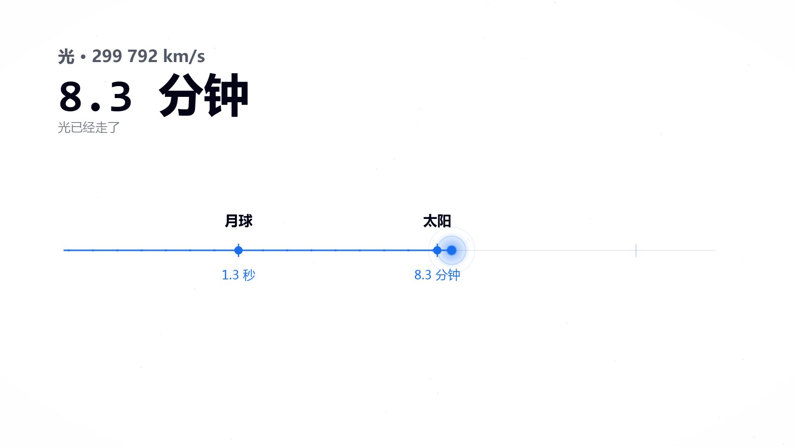

# BAR —— 标杆图集（正反面对照）

> **为什么需要标杆图集**：`anim check` 只守「地板」（不黑屏、不 NaN、不越界），不判「像不像一支成片」。
> 模型自评如果没有参照物，就会把「过了地板」当成「做得不错」。
> 本页把正反面样帧钉死在这里，供创作自检与 `CRAFT-RUBRIC` 独立审查时做**逐帧成对比较**。

---

## 一、反面样本（不要再交出这种画面）

### 1. `tasks/light-seconds` · t = 10.0s（1 分锚点）

> 背景：虽然通过了 `qa` 与期望值校验，但整片仅 1 个场景 `scenes/travel.js`（110 行），绕开了风格包、`type.write`、`world` 与摄影机。

| 位置 / 现象 | 出了什么问题 | 对应评分维度 | 怎么改才对 |
|---|---|---|---|
| **整幅画面右下与右侧大片空白** | 16×9 网格中超过 70% 区域只有纯白背景（`#fbfbfd`），主体仅占一条水平细线 | ② 构图与填充（≤ 1 分） | 主体尺度应占画面 30–60%；给光程、天体尺度（地球/月球/太阳相对圆盘或对数标尺带）足够的图形面积 |
| **「8.3 分钟」与「光已经走了」字体脱节** | 左上数字用系统默认 `monospace`，中文却用 `sans-serif`，且字重与行距没有与风格包绑定；底部标尺更用 `rgba(...)` 硬编码 | ③ 层级 / ⑦ 风格辨识度 | 走风格包 `type.write*` + `style.fonts` 与调色板 `css(P.x)`；数字与中文同源或明确配对，禁止裸 `fillText` |
| **月球 / 太阳只是一个圆点** | 抽象概念（天文尺度、光速有限）退化成「一条线 + 两个点」，不听旁白/文字根本看不出在讲光速 | ① 主体与隐喻（1 分） | 概念必须视觉化：地月真实尺度比例条 + 连续光脉冲波前推进 + 太阳占半屏或带能量光晕，不靠字解释也能看懂 |
| **只有纯色平面，无背景世界与景深** | 背景 `fillRect('#fbfbfd')` 没有任何材质、坐标、光影或景深；全片无共享 `world` 与摄影机推拉 | ④ 深度层次 / ⑥ 连续性 | 声明 `export const world` 与 `world: 'auto'`，配全片摄影机（`cameraPost` / `makeShot`），拉出「背景世界 / 中景主体 / 前景标注」三层 |
| **全片只有 1 段、无起伏** | 20 秒从头平推到尾，没有分段转场，也没有明确的单一高光时刻 | ⑤ 运动分层 / ⑧ 高光时刻 | 拆出明确段型（hook / mechanism / close），每段只设一个卡住关键词的高光揭晓 |

---

### 2. `tasks/optifine` · t = 120.0s（局部反面样本）

> 背景：optifine 花了大量功夫做了 3D 世界（例如 t=40s 的区块重建镜头表现扎实），但在这一帧仍然同时犯了四个典型错，而且机器门一条都没有拦住。

| 位置 / 现象 | 出了什么问题 | 对应评分维度 | 怎么改才对 |
|---|---|---|---|
| **右侧顶部「八格，各两种可能」数字 1/0 压字** | 方块里的 `1`/`0` 与下方「右上」「右下」「左下」「左上」小字及框线相互挤压、部分被横线穿过 | ③ 层级 / ② 构图与填充 | 先算好安全矩形与留白间距，数字居中放在块内或留 ≥ 16px 净距；同类标签收进 `labelRow` 或错开基线 |
| **右侧面板下半区空洞，且背景 3D 透出来** | 「八格，各两种可能」面板框占满右半屏，但下半部分 60% 区域几乎全空；同时面板底色透明度太高，底层 3D 方块边缘穿过了表格与方格，打断视觉焦点 | ② 构图与填充 / ④ 深度层次 | 面板高度只包住实际内容（或把 256→47 种归约图示填进下半区）；前景面板压实底色（`alpha ≥ 0.9`）或压暗背景世界 `tone × 0.25`，**压暗用 tone 不用透明度** |
| **底部大字「八个邻居，每个只有"连"和"不连"两种可能。」** | 把旁白原话整句当成画面大字（还占着底部说明带），和上方「2^8 = 256 种情况」语义重叠 | ① 主体与隐喻 / `CAPTIONS.md` §2 | 画面只留标注（`8 邻接 · 2^8 = 256`、`归约 → 47`），完整句子交给旁白与引擎字幕层 |

---

## 二、正面标杆（待第三阶段风格帧确认后补入）

> 说明：第一批正面标杆将取自新流程下的讲解片 `tasks/oklab` 风格帧。待用户审看 3 张风格帧并点头后，把图片复制到 `docs/images/bar/`，并在本节逐张写清：
> 1. 画面好在哪（对应 `CRAFT-RUBRIC` 8 维得分与具体元素）；
> 2. 对应的代码路径与行号（场景文件、shader / kit / 摄影机写法）。
