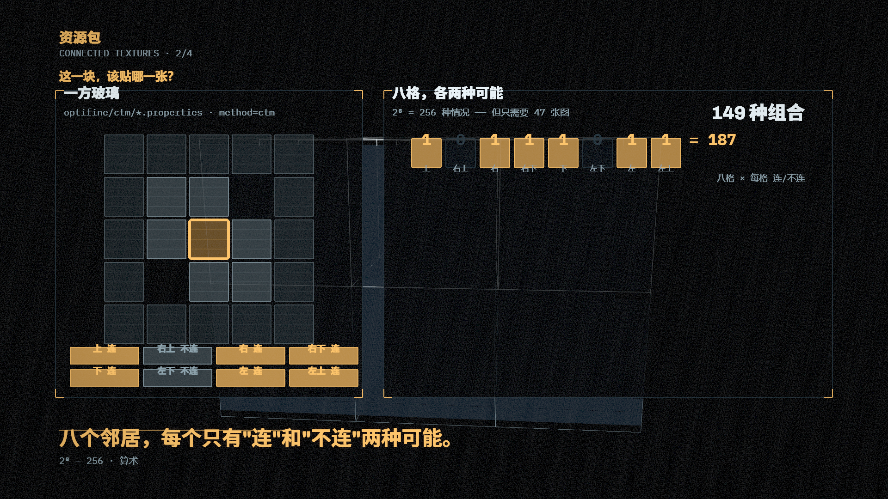
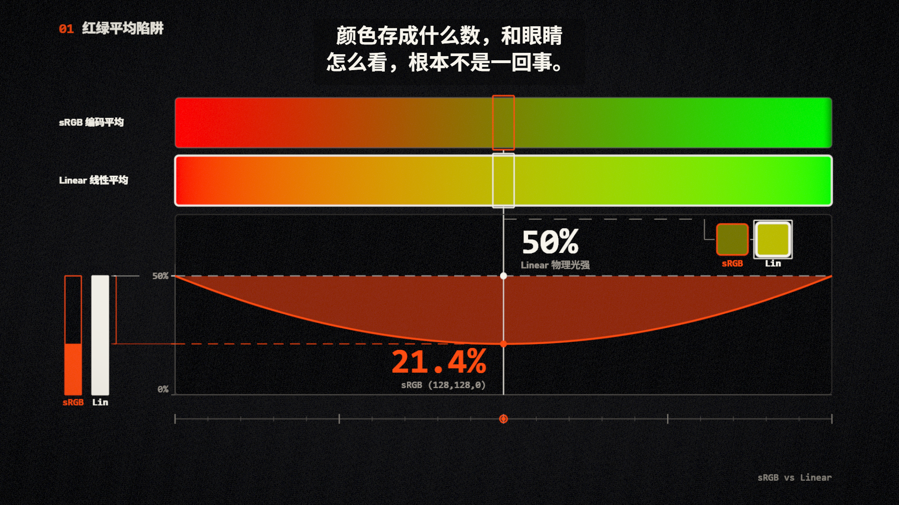
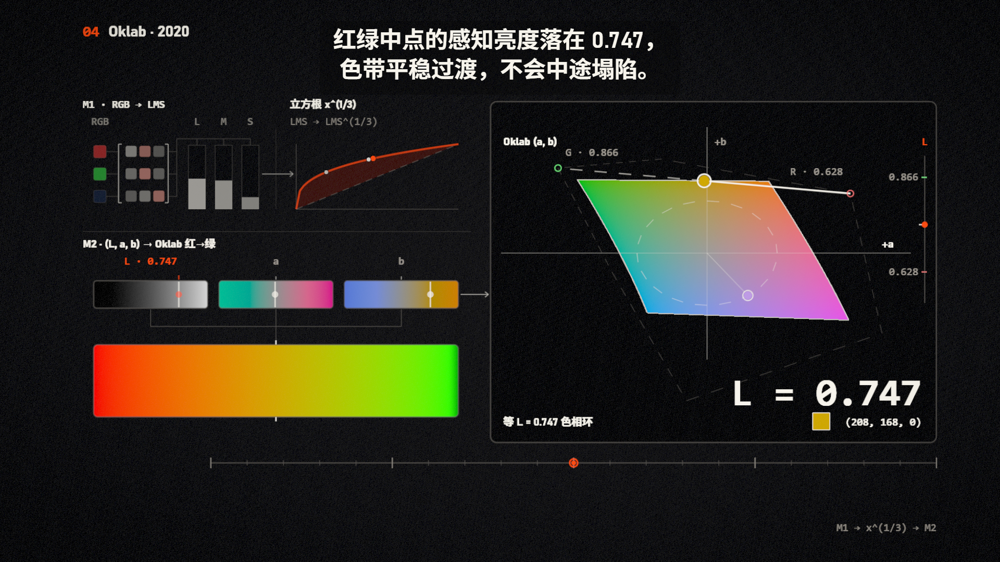
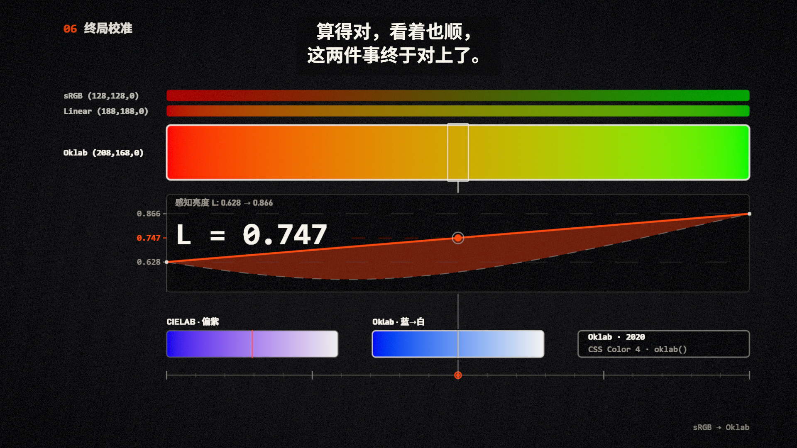

# BAR —— 标杆图集（正反面对照）

> **为什么需要标杆图集**：`anim check` 只守「地板」（不黑屏、不 NaN、不越界），不判「像不像一支成片」。
> 模型自评如果没有参照物，就会把「过了地板」当成「做得不错」。
> 本页把正反面样帧钉死在这里，供创作自检与 `CRAFT-RUBRIC` 独立审查时做**逐帧成对比较**。

---

## 一、反面样本（不要再交出这种画面）

### 1. `tasks/light-seconds` · t = 10.0s（1 分锚点）

> 背景：虽然通过了 `qa` 与期望值校验，但整片仅 1 个场景 `scenes/travel.js`（110 行），绕开了风格包、`type.write`、`world` 与摄影机。

| 位置 / 现象 | 出了什么问题 | 对应评分维度 | 怎么改才对 |
|---|---|---|---|
| **整幅画面右下与右侧大片空白** | 16×9 网格中超过 70% 区域只有纯白背景（`#fbfbfd`），主体仅占一条水平细线 | ② 构图与填充（≤ 1 分） | 主体尺度应占画面 30–60%；给光程、天体尺度（地球/月球/太阳相对圆盘或对数标尺带）足够的图形面积 |
| **「8.3 分钟」与「光已经走了」字体脱节** | 左上数字用系统默认 `monospace`，中文却用 `sans-serif`，且字重与行距没有与风格包绑定；底部标尺更用 `rgba(...)` 硬编码 | ③ 层级 / ⑦ 风格辨识度 | 走风格包 `type.write*` + `style.fonts` 与调色板 `css(P.x)`；数字与中文同源或明确配对，禁止裸 `fillText` |
| **月球 / 太阳只是一个圆点** | 抽象概念（天文尺度、光速有限）退化成「一条线 + 两个点」，不听旁白/文字根本看不出在讲光速 | ① 主体与隐喻（1 分） | 概念必须视觉化：地月真实尺度比例条 + 连续光脉冲波前推进 + 太阳占半屏或带能量光晕，不靠字解释也能看懂 |
| **只有纯色平面，无背景世界与景深** | 背景 `fillRect('#fbfbfd')` 没有任何材质、坐标、光影或景深；全片无共享 `world` 与摄影机推拉 | ④ 深度层次 / ⑥ 连续性 | 声明 `export const world` 与 `world: 'auto'`，配全片摄影机（`cameraPost` / `makeShot`），拉出「背景世界 / 中景主体 / 前景标注」三层 |
| **全片只有 1 段、无起伏** | 20 秒从头平推到尾，没有分段转场，也没有明确的单一高光时刻 | ⑤ 运动分层 / ⑧ 高光时刻 | 拆出明确段型（hook / mechanism / close），每段只设一个卡住关键词的高光揭晓 |

---

### 2. `tasks/optifine` · t = 120.0s（局部反面样本）

> 背景：optifine 花了大量功夫做了 3D 世界（例如 t=40s 的区块重建镜头表现扎实），但在这一帧仍然同时犯了四个典型错，而且机器门一条都没有拦住。

| 位置 / 现象 | 出了什么问题 | 对应评分维度 | 怎么改才对 |
|---|---|---|---|
| **右侧顶部「八格，各两种可能」数字 1/0 压字** | 方块里的 `1`/`0` 与下方「右上」「右下」「左下」「左上」小字及框线相互挤压、部分被横线穿过 | ③ 层级 / ② 构图与填充 | 先算好安全矩形与留白间距，数字居中放在块内或留 ≥ 16px 净距；同类标签收进 `labelRow` 或错开基线 |
| **右侧面板下半区空洞，且背景 3D 透出来** | 「八格，各两种可能」面板框占满右半屏，但下半部分 60% 区域几乎全空；同时面板底色透明度太高，底层 3D 方块边缘穿过了表格与方格，打断视觉焦点 | ② 构图与填充 / ④ 深度层次 | 面板高度只包住实际内容（或把 256→47 种归约图示填进下半区）；前景面板压实底色（`alpha ≥ 0.9`）或压暗背景世界 `tone × 0.25`，**压暗用 tone 不用透明度** |
| **底部大字「八个邻居，每个只有"连"和"不连"两种可能。」** | 把旁白原话整句当成画面大字（还占着底部说明带），和上方「2^8 = 256 种情况」语义重叠 | ① 主体与隐喻 / `CAPTIONS.md` §2 | 画面只留标注（`8 邻接 · 2^8 = 256`、`归约 → 47`），完整句子交给旁白与引擎字幕层 |

---

## 二、正面标杆（对齐目标）

> 说明：第一批正面标杆取自新流程下的讲解片 [`tasks/oklab`](../tasks/oklab/task.config.mjs)（`round-29` 主模型独立审查 48 项全 ≥ 4，全片 `layout.guard` 0 告警，`lint-craft` 100/100，5 处切点 `railU`/`zoomBoost` 连续归零）。创作自检与 `CRAFT-RUBRIC` 独立审查时，将候选帧与下方三张正面锚点、以及 §一两张反面锚点做成对比较。

---

### 1. `tasks/oklab` · `hook`（段内 85% · t = 17.71s · 均分 4.50）

> 8 维得分：**隐喻 5 / 填充 4 / 层级 5 / 深度 4 / 运动 5 / 连续 4 / 风格 4 / 高光 5 = 4.50**（`round-29`）。

| 位置 / 元素 | 好在哪里 | 对应评分维度 | 源码锚点（文件路径与行号） |
|---|---|---|---|
| **双红绿渐变带 + 同轴光强凹谷阴影** | 用 GLSL 实时计算 `evalRedGreenSrgb` vs `evalRedGreenLinear`，在 `u=0.5` 处将物理光强塌陷区拉出真实阴影面积；不听旁白也能一眼看懂「编码平均 ≠ 物理光强平均」 | ① 主体与隐喻（5 分） | [`tasks/oklab/scenes/hook.js`](../tasks/oklab/scenes/hook.js#L20-L134)（GLSL 双色带 / 误差带 / 放大样块）；[`_oklab.js`](../tasks/oklab/scenes/_oklab.js#L93-L194)（共享 GLSL 算子） |
| **`21.4%` vs `50%` 对比数阶 + 右上放大样块** | `72px` 唯一信号橙主数字 `21.4%` 与 `20px` 标注构成 `3.6:1` 字阶（同屏 ≤ 3 档字号）；右侧 64×64 放大样块交替聚焦，信号色只点唯一焦点 | ③ 层级（5 分）/ ⑧ 高光时刻（5 分） | [`tasks/oklab/scenes/hook.js`](../tasks/oklab/scenes/hook.js#L103-L130)（放大样块）、[`L390-L422`](../tasks/oklab/scenes/hook.js#L390-L422)（字阶层级与引导） |
| **`flat` 暗调摄影棚三层深度 + 左栏实时量柱** | 世界层（`worldPass`）压暗退后，中景凹陷框（`C_INK * 0.76`）稳托实时曲线与左栏对比量柱；底栏 `spectrum-rail` 与 `cameraAt` 全程呼吸，并在切点前以 `zoomRelease` 平滑归零 | ② 填充（4）/ ④ 深度（4）/ ⑤ 运动（5）/ ⑥ 连续（4）/ ⑦ 风格（4） | [`tasks/oklab/scenes/hook.js`](../tasks/oklab/scenes/hook.js#L208-L259)（左栏量柱与参考线）、[`L427-L430`](../tasks/oklab/scenes/hook.js#L427-L430)（`zoomRelease`）；[`_oklab.js`](../tasks/oklab/scenes/_oklab.js#L224-L263)（`drawSpectrumRail` 与 `oklabPost`） |

---

### 2. `tasks/oklab` · `oklab_mech`（段内 85% · t = 69.00s · 均分 4.38）

> 8 维得分：**隐喻 5 / 填充 4 / 层级 4 / 深度 5 / 运动 5 / 连续 4 / 风格 4 / 高光 4 = 4.38**（`round-29`）。

| 位置 / 元素 | 好在哪里 | 对应评分维度 | 源码锚点（文件路径与行号） |
|---|---|---|---|
| **左侧无框三步数学管线 → 右侧实时 `L(u)` GLSL 色域切片** | Stage 1（`RGB→M1→LMS` 权重格与柱）、Stage 2（`x^(1/3)` 暗部压缩面积）、Stage 3（`M2` 真实 `L/a/b` 条与校准带）无边框直浮暗调摄影棚，与右侧实时随 `L` 变形的 `(a, b)` sRGB 色域切片与边界轮廓构成因果工作台 | ① 主体与隐喻（5 分）/ ④ 深度层次（5 分） | [`tasks/oklab/scenes/oklab_mech.js`](../tasks/oklab/scenes/oklab_mech.js#L30-L193)（GLSL 三步管线与实时色域切片）、[`L270-L310`](../tasks/oklab/scenes/oklab_mech.js#L270-L310)（无框流式接管线） |
| **词点驱动阶段聚光 + 整帧数字防重影** | 随旁白节点切换 `tone1/tone2/tone3` 聚焦当前步骤；运动模糊下用主帧整型号 `ltFrame` 驱动动态数字 `L = 0.747`，彻底消灭子帧叠字重影，并在切点前主动 `zoomRelease` 归零 | ② 填充（4）/ ③ 层级（4）/ ⑤ 运动（5）/ ⑥ 连续（4）/ ⑧ 高光（4） | [`tasks/oklab/scenes/oklab_mech.js`](../tasks/oklab/scenes/oklab_mech.js#L226-L252)（词点 tone 分层与 `ltFrame`）、[`L582-L610`](../tasks/oklab/scenes/oklab_mech.js#L582-L610)（`L = 0.747` 读数与 `zoomRelease`） |

---

### 3. `tasks/oklab` · `close`（段内 85% · t = 97.31s · 均分 4.75）

> 8 维得分：**隐喻 5 / 填充 5 / 层级 5 / 深度 4 / 运动 5 / 连续 5 / 风格 4 / 高光 5 = 4.75**（`round-29`）。

| 位置 / 元素 | 好在哪里 | 对应评分维度 | 源码锚点（文件路径与行号） |
|---|---|---|---|
| **三代色带压暗重聚 + 亮度曲线弹簧弹直** | 开场主角 sRGB 与 Linear 退居配角压暗（`dimTone = 0.42`），128px 高 `Oklab (208,168,0)` 居中展开；开场 `hook` 的光强凹陷曲线通过 `spring` 弹直为线性 `L: 0.628→0.747→0.866`，完成全片视觉母题闭环 | ① 主体与隐喻（5 分）/ ⑥ 连续性（5 分）/ ⑧ 高光时刻（5 分） | [`tasks/oklab/scenes/close.js`](../tasks/oklab/scenes/close.js#L25-L117)（GLSL 三代色带与弹直阴影）、[`L194-L216`](../tasks/oklab/scenes/close.js#L194-L216)（`spring` 弹直与几何收束） |
| **同轴三列底栏验证 + `L=0.581→0.747` 交叉淡化** | 底栏三列与主色带严格对齐 `x=400..1760`（中栏 C2 中心落于 `midX=1080`），对照 CIELAB 偏紫与 Oklab 纯净蓝→白及 `CSS Color 4`；数字切换以 `preSnapA`/`snap` 交叉淡化，片尾 `endFade` 平滑落黑 | ② 填充（5 分）/ ③ 层级（5 分）/ ④ 深度（4）/ ⑤ 运动（5）/ ⑦ 风格（4） | [`tasks/oklab/scenes/close.js`](../tasks/oklab/scenes/close.js#L118-L163)（三列底栏 GLSL）、[`L405-L440`](../tasks/oklab/scenes/close.js#L405-L440)（`L=0.581→0.747` 交叉淡化与三列标注） |
