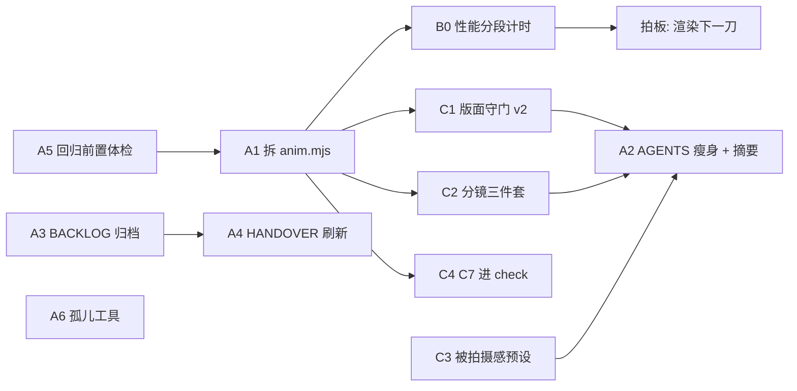

# ai-anim 改进计划（2026-11-08）

> **状态**：执行中。2026-11-13 已按当前工作区核对，详见下方进度表。原始方案与验收要求保留在后文；每做完一项同步销账到 [`BACKLOG.md`](BACKLOG.md)，全部收口后按惯例归档本文件至 [`history/`](history/README.md)。
>
> **总原则**：三条主线并行收敛 —— **工程健康 / 出片效率 / 画面下限**。
> 每一项都写明：为什么做、改哪里、怎样算做完、风险在哪。**画面行为的改动都默认关闭或只报读数**，老片子保持逐像素不变。

---

## 2026-11-13 进度核对

核对基点为本地 `master` 的 `dbbc2d8`。进度依据文件、调用路径与提交记录，按后文完整验收范围计为完成 2 项、部分完成 4 项、未完成 5 项。

| 工作项 | 状态 | 已核实的进展与剩项 |
|---|---|---|
| A1 CLI 拆分 | **完成**（2026-11-13，`3969b6b` + `a0afdfe`） | 入口 303 行（<400），42 命令模块 + 9 共享模块，会话 getter 收口，布局测试 42/42 进 CI。**渲染对拍**：`git diff ca58211 HEAD -- src/` 为空（引擎逐字节未变，拆分只动 scripts/tools）+ 新 CLI 驱动 `determinism demo` 24 帧三序列逐像素一致。**断言条数**：carry 37 / layout 47 / shots 243 / tasks-meta 15 / tier-estimate 12 / timeline-audit 26 / variants 16 等与拆分前一致。**文档行号**：DIAGNOSIS 74 处 + STATUS/REFERENCE 3 处已按诊断文本锚定迁到 cmd/lib（`a0afdfe`）。help/shots/styles 逐字节一致，tasks 差异仅新增 _lens-travel。CI 77/77 |
| A2 AGENTS 瘦身与摘要 | 部分完成 | 前置摘要和注入截断检查已落地，铁律表末尾位于 22892 B，引用检查零断链。文件 51254 B，尚未达到本计划 ≤50 KB 的体积目标 |
| A3 BACKLOG 归档 | 完成 | 主文件 20401 B，历史记录迁至 `docs/history/BACKLOG-done-2026-10.md`，原编号保留归档指针，WebCodecs 条目已改为等待 B0 |
| A4 HANDOVER 刷新 | 部分完成 | 交接页已重写并补充 11-13 交接，仍缺计划指定的 `history/HANDOVER-2026-11-04.md`，旧机器快照与最新运镜进展还需收口 |
| A5 回归依赖体检 | 部分完成 | needs、环境跳过提示与声明守门已接入。Chrome 回退路径把 playwright-core 目录存在视为浏览器可用；受控的“无 Chrome、仅安装包”夹具仍返回 chrome=true，缺失能力的识别尚待补齐 |
| A6 孤儿工具整理 | 完成 | 5 个 nuomi 工具已迁到 `tasks/nuomi/tools/`，probe-app-scale 已登记在 DIAGNOSIS，probe-text-alpha 已清理 |
| B0 性能分段计时 | 未完成 | PERF 有历史测量，尚无本计划要求的 `anim perf --breakdown`、三个样本的完整分桶及编码器对照表 |
| C1 版面守门 v2 | 未完成 | 现有逻辑仍以文字块数和主体区为主，overlap / offFrame / captionHit 三项与实际字幕 bbox 接线待做 |
| C2 分镜三件套 | 未完成 | 原 brief 已有分段表，placeholder 镜头、board 命令与测试、逐段替换工作流待做 |
| C3 被拍摄感预设 | 未完成 | `post-presets.js`、preset 三入口、四档夹具及回归测试尚未落地 |
| C4 C7 接入 check | 未完成 | 独立 anti-ppt 工具有运动方差检测，check 尚无 C7 读数；共享 `decodeDiffSeries()` 与接线测试待做 |

本次完整 CI 初跑为 75/76，唯一失败来自 `test-relay.mjs` 把模式总数固定为 15。加入 corners / seam 后注册表为 17，已同步更新断言，针对性复验 relay 37/37、转场模式 24 项通过，随后完整回归复跑 76/76 通过。日志位于 `out/plan-audit-2026-11-13/`，汇总位于 `out/_regress/summary.md`。

用户已明确认可 `_lens-travel` 的运镜。9 秒有声版 `out/_lens-travel/lens-travel-v2.mp4` 为 1920×1080 / 60fps / 540 帧，采用偏轴穿行、近景遮挡、弧长参数化路径和减速抵达，代码与声音已提交到 [PR #9](https://github.com/suan-11/ai-anim/pull/9)。它为后续相机复用提供参考。镜组为简化模型，黑白九块及鱼印方向仍已放弃。

后续依照本计划优先推进 A1 的命令拆分、B0 的当前机器分段测量，再接 C4 的运动节奏读数。C3 的后处理实现继续按原验收要求单独核实。

## 0. 基线实测读数（2026-11-08，计划中每条判断的依据）

| 量 | 读数 | 含义 |
|---|---|---|
| `regress-all --ci` | **75/75 全绿**（`ffmpeg` 在 PATH 中可用时） | 现有代码本身健康；未将 `ffmpeg` 加入当前 shell PATH 时会红一片，**满屏 ENOENT 堆栈里没有一句"缺 ffmpeg"** |
| `scripts/anim.mjs` | **8436 行 / 457 KB / 39 个 `cmd` / 146 个顶层函数** | 单文件过重（agent 完整阅读需分十余段读取）。`cmdCheck` 约 1130 行，`cmdVideo` 约 1000 行 |
| 按源码文本断言 `anim.mjs` 的测试 | **12 个**（`readFileSync('scripts/anim.mjs')`），另有 2 个直接 `import` 它的导出 | 直接拆文件，这些测试会变红，或者静默失去覆盖 |
| `AGENTS.md` | **61,934 B**（硬线 65,536 B 的 94.5%） | 按文件自身预算仅余 3,602 B |
| **部分宿主实际注入的 `AGENTS.md`** | **仅前 23,975 B**（实测截断在 §4 铁律表第 4 行末尾） | §4 铁律表第 5 行起，以及 §4.5、§5–§10，**在带头部截断限制的宿主下注入阶段看不到**（需靠前置摘要或显式 Read） |
| `docs/BACKLOG.md` | **106 KB**：53 行已完成、15 行仍开着 | 大部分篇幅为历史销账记录 |
| `docs/HANDOVER.md` | 写着另一台工作机的绝对路径、`qyac` 远端、"70/70"、"没有 libx264、nvenc 不可用" | 描述的是**上一台机器**的环境与状态 |
| 参考测试机硬件与编码器 | Ryzen 7 3700X（16 线程）/ 16 GB / **RTX 2060** + 虚拟显示卡；`libx264` 与 `h264_nvenc` 均能实测编码 | [`PERF.md`](PERF.md) 里关于 AMD 核显、`h264_mf` 回退的性能结论**未必适用于所有开发机** |
| 孤儿工具 | **7 个**（`tools/nuomi-*.mjs` ×5、`tools/probe-app-scale.mjs`、`tools/probe-text-alpha.mjs`） | 回归清单与文档均未引用 |
| 版面守门 `src/layout.js` | 只数**块数**（每屏块数、主体区内外块数） | **不判**字压字、出画、与真实字幕 bbox 相撞（见该文件头诚实清单） |
| `tasks/_ideas.md` | 候选池为空、"已发"表为空 | — |

---

## 1. 需关注的边界与待定事项

### 边界说明

1. **`AGENTS.md` 在截断型宿主下的真实窗口只有 ~24 KB，而非 64 KB**：
   - 仅压到 ≤ 50 KB 可以腾出文件修改余量，但**解决不了"前 24 KB 看不到 §4 后半与 §10 交付门"**的问题。
   - 因此 A2 建议分两步：先压到 ≤ 50 KB，再在前 24 KB 内增加一段 **≤ 3 KB 的必读摘要**（置于 `§0` 之后），把 `§4` 全部铁律、`§10` 交付门和关键"写错不报错"陷阱浓缩进前 24 KB。
2. **`anim.mjs` 拆分与源码文本测试的兼容性**：
   - 12 个测试文件直接 `readFileSync('scripts/anim.mjs')` 做接线自检；拆分前必须先落地 `readCliSource()`，保证一条断言都不删、语义不变，同时拆分前后对 CLI 输出与 `out/` 产物做逐字节对拍。
3. **WebCodecs（`1-7ⓑ`）本轮不直接动手改出片路径**：
   - 目标机具备独显（如 RTX 2060）及可用的 `libx264` / `h264_nvenc`，与原 [`PERF.md`](PERF.md) 测量环境不同；且正式成片走自适应子帧（8–216 子帧），瓶颈极大可能在 GPU 渲染端而非传输端。必须先做 Phase 0 分段计时（B0），拿实测数据再拍板。

### 待定事项（留给开发者决定）

1. **`AGENTS.md` 前置必读摘要**：是否置于 `§0` 之后并把 `§4` 末尾推进前 24,000 B？（推荐：**做**，待最终拍板）
2. **`tasks/_ideas.md` 种子**：是否参照既有成片模式先补 5 条候选选题种子？（待定，不阻塞工程实施）
3. **Git 提交粒度**：建议按工作项拆分提交，其中 A1 拆成「加 `readCliSource()` → 机械拆分 → 清理旧代码并更新文档行号」3 个提交方便 bisect（待定，执行时按需切分）。
4. **不在本轮范围的既有片子欠账**：`pv-kattachi` 尾段歌词错位、`pv-king` 补音效与 `state`/`relayTo` 等继续留在 [`BACKLOG.md`](BACKLOG.md)（待后续单开排期）。

---

## 2. 总体排期与依赖



- **A1 放在前置阶段**：C1 / C2 / C4 均需改动 `check` 或新增子命令，先拆后改可避免在 8400 行单文件内制造大规模冲突。
- **A2 放在最后阶段**：本轮新增的命令、模板、参数与守门规则先写入 `docs/`，最后统一精简收口进 `AGENTS.md`，避免改两遍。

| 阶段 | 工作项 | 粗估 |
|---|---|---|
| 阶段 1 | A5（前置体检）· A6（孤儿工具）· A3（BACKLOG 归档） | 半天 |
| 阶段 2 | A1（拆分 `scripts/anim.mjs`） | 1–1.5 天 |
| 阶段 3 | B0（性能分段计时，只测量） | 半天 |
| 阶段 4 | C1（版面守门 v2）· C2（分镜三件套）· C3（被拍摄感预设）· C4（C7 进 `check`） | 2–3 天 |
| 阶段 5 | A2（AGENTS 瘦身 + 摘要）· A4（HANDOVER 刷新）· 收尾核对与文档生成 | 半天 |

---

## 3. A 线：工程健康

### A1. 拆分 `scripts/anim.mjs`（一命令一文件，行为零改动）

**目标目录结构**

```text
scripts/
  anim.mjs                 # 只留：参数解析 / 命令表 / 分发 / IS_MAIN / 对外 re-export（目标 < 400 行）
  cmd/
    check.mjs
    video.mjs
    still.mjs
    hashes.mjs
    audit.mjs
    ...                    # 共 39 个，每个 export async function run()
  lib/cli/
    args.mjs               # opt / flag / pickTask / rest argv
    log.mjs                # log / warn / die / 颜色
    session.mjs            # openSession / closeSession / 共享 session 对象（仅提供 getter）
    paths.mjs              # ROOT / taskOut / 变体路径
    sheet.mjs              # writeContactSheet 等跨命令共享的出图 helper
    ...                    # 按引用图再归 1–3 个域文件
tools/lib/cli-source.mjs   # [NEW] readCliSource()
```

**执行步骤（机械拆分，不顺手改逻辑）**

1. **先行接入 `readCliSource()`**：新增 `tools/lib/cli-source.mjs`，将 `scripts/anim.mjs`、`scripts/cmd/*.mjs`、`scripts/lib/cli/*.mjs` 按确定顺序拼接返回；将 12 个读取 `scripts/anim.mjs` 源码做接线自检的测试切换至 `readCliSource()`，先跑一轮确认 75/75 全绿。
   - 受影响测试：`test-carry` `test-layout` `test-motion-assert` `test-motion-caps` `test-segment-cuts` `test-shots`（两处） `test-tasks-meta` `test-tier-estimate` `test-timeline-audit` `test-variants` `test-media-qa`（以及需关注直接 `import` 导出的 `test-notes` / `test-subs`）。
2. **存留拆分前基准**：将 `help` / `tasks --json` / `shots --json` / `styles` 的标准输出与 `regress-all --ci` 各测试的断言条数存为对拍基准。
3. **按引用图机械搬移**：只被单个 `cmd` 调用的 helper 随该命令进入 `scripts/cmd/<名>.mjs`；跨命令共用的 helper 进入 `scripts/lib/cli/`；模块级可变状态（如 `session`）收口在 `session.mjs` 并仅导出 getter。函数体逐字不改，只补 `import` / `export`；`anim.mjs` 原有对外导出（`IS_MAIN` `assText` `assTime` 及 `test-notes` 依赖项）保留 re-export。
4. **删旧并同步文档**：删除原文件残留实现；将 [`DIAGNOSIS.md`](DIAGNOSIS.md) 等文档中指向 `scripts/anim.mjs` 的旧行号与位置更新至对应新文件。

**验收标准**
- `regress-all --ci` 全绿，且**每个测试的断言条数与拆分前完全一致**；
- `anim help`、`tasks --json`、`shots --json`、`styles` 输出**与拆分前逐字节一致**；
- 实跑 `still demo -t 1,6`、`check demo --quick`、`video demo --draft --from 0 --to 2`，产物路径、行为与退出码不变；
- 新增 `tools/test-cli-layout.mjs`（挂入 `regress-all --ci`）：校验 `scripts/cmd/*.mjs` 与命令表双向覆盖无遗漏，且 `scripts/anim.mjs` 行数 `< 400`。

---

### A2. `AGENTS.md` 瘦身 + 前置必读摘要

1. **压至 ≤ 50 KB**：将 `§10`（8.9 KB）、`§5`（6.7 KB）、`§7`（6.4 KB）、`§6`（5.7 KB）中的查表内容下沉至 [`ENGINE.md`](ENGINE.md) / [`PERF.md`](PERF.md) / 新建的 `docs/DELIVERY.md`（放交付长清单）；原位置只保留**门、写错不报错的坑、带触发条件的指针**。
   - 保持全部现有章节号与子节编号（如 `§10.10`、`§10.11.56` 等外部锚点）**一个不删**；被下沉的子节保留标题，正文缩为一行指针。
2. **前置必读摘要（≤ 3 KB）**：放在 `§0` 之后（作为 `§0.5`），覆盖 `§4` 全部铁律（一行一条）、三条交付门、以及后半部分最容易踩且不报错的坑，确保仅被注入前 24 KB 的环境也能拿到关键约束。
3. **扩展守门 `tools/lint-agents-size.mjs`**：新增判据检查 `§4` 铁律表末尾的字节偏移是否落在 `AGENTS_INJECT_BUDGET`（默认 `24000`）之内，超限给出明确警告。
4. **验收**：`node tools/lint-agents-size.mjs` 与 `node tools/lint-agents-refs.mjs` 双绿。

---

### A3. `BACKLOG.md` 归档瘦身

- 将已完成的 53 条记录（含顶部按日期堆叠的历史批次说明）原样迁入 `docs/history/BACKLOG-done-2026-10.md`；主文件仅保留仍在开放的条目、`§0` 拍板区、磁盘清理现状及维护规则（目标 ≤ 25 KB）。
- 严格遵守 `BACKLOG.md` 维护规则：外部仍在引用的编号（如 `1-19` `1-45` 等）在主文件保留一行「已归档 → 链接」，不静默删除。
- 同步修正失实条目：更新 `1-7ⓑ` 为「等待 B0 实测数据后再定」；按仓库实际情况改写 `1-49`（移除仓库中不存在的私有任务抽取描述）。

---

### A4. 刷新 `HANDOVER.md` 至当前机器与状态

将原 `docs/HANDOVER.md` 归档至 `docs/history/HANDOVER-2026-11-04.md`，重写当前交接页：
- 当前工作区相对口径、上游远端 `suan-11/ai-anim`、CI 回归 `75/75`；
- 环境坑更新：ffmpeg 位于独立安装目录或 User PATH（修改 PATH 后需重开 shell 才对新会话生效，或显式设置 `ANIM_FFMPEG`）、本机独显（RTX 2060）+ 虚拟显示卡场景、`libx264` 与 `h264_nvenc` 可用性（结合 B0 实测结果）；
- 待办指针指向 `BACKLOG.md` 与本计划文档。

---

### A5. `regress-all.mjs` 前置依赖体检

- 在串行执行测试清单前，根据本次筛选出的 `list` 的 `needs` 声明，统一探测 `ffmpeg` / `ffprobe`（尊重 `ANIM_FFMPEG` / `ANIM_FFPROBE`）与 Chrome 可用性。
- 若缺项，**用一行说清缺失项及最常见原因/修法**（例如探测到常见安装位置或 User PATH 中已有 `ffmpeg` 但未进当前 shell PATH 时，提示重启 shell 或配置 `ANIM_FFMPEG`）：
  - 依赖缺失能力的测试直接记为 `skipped(env)`，不再各自打出一屏 `ENOENT` 堆栈；
  - 汇总明确标注「**环境问题，不是代码问题**」，且整体以非零码退出。
- 在 `ITEMS` 条目上补充 `needs: ['ffmpeg']` 等声明；`tools/test-ci-coverage.mjs` 同步补一条静态守门，防止新增依赖项漏标 `needs`。

---

### A6. 清理 7 个孤儿工具

- `tools/nuomi-shuffle.mjs` / `nuomi-skins.mjs` / `nuomi-vary.mjs` / `nuomi-vo-ja.mjs` / `nuomi-vo.mjs` 迁入 `tasks/nuomi/tools/`（修复内部的 `ROOT` 相对路径与文件头注释）。
- 检查 `tools/probe-app-scale.mjs` 与 `tools/probe-text-alpha.mjs`：若仍有诊断价值则登记进 [`DIAGNOSIS.md`](DIAGNOSIS.md)，不再使用则清理并在提交信息中注明删除清单。

---

## 4. B 线：出片效率 —— 渲染提速 Phase 0（只测量，不改出片路径）

**定位**：先测后切，不凭早期 AMD 核显机器上的读数盲目上 WebCodecs。产出一节与一张实测表写入 [`PERF.md`](PERF.md)。

| 测量项 | 测量方法 |
|---|---|
| 无头 Chrome 实际选用的 GPU | `anim gpu` 分别对 `--gpu auto` 与 `--gpu high` 取 adapter，核实是否命中独显（RTX 2060）还是回落到了虚拟显示卡 |
| 逐帧耗时分桶 | 扩展 `anim perf` 增加 `--breakdown`：页面侧采集渲染耗时与 `readNV12` 回读耗时，Node 侧采集 WebSocket 收帧与 ffmpeg stdin 背压耗时 |
| 样本集合 | `pv-king` 歌词段（2D 文字重）+ `_three-lab`（Three.js 真网格）+ `demo` 甩镜段（吃 72 子帧），各取 5 秒，`--samples auto` |
| 编码器横向对比 | 同一片段分别走 `libx264`、`h264_nvenc`、`h264_mf`（对齐画质/码率档），比对 fps 与输出体积 |

**拍板门槛**：
- 若渲染耗时占比 > 70%：优先确保默认命中独显、排查自适应子帧与着色器热点（暂不上 WebCodecs）；
- 若传输 + 编码耗时占比 > 40%：立项实施 `1-7ⓑ` WebCodecs 管线。

---

## 5. C 线：画面下限

### C1. 版面守门 v2：字压字 / 出画 / 撞字幕

沿用 [`src/layout.js`](../src/layout.js) 纯函数判据模式，接入 `src/app.js` 的 `layoutAudit()` 与 `check`；**默认只 warn，`--strict` 才进 `errs`**。

| 新判据 | 判定口径 | 数据来源 |
|---|---|---|
| `overlap` 字压字 | `textGroups` 聚类合并后的任意两块文字 bbox 交叠面积 `>` **较小块面积的 15%** | 现有文字绘制账（`x / y / size / 实测宽度`） |
| `offFrame` 出画 | bbox 越出画幅（`0..W`, `0..H`）记 `error` 级；越出安全边距 `grid.pad` 记 `warn` 级 | 同上 + 风格栅格 |
| `captionHit` 撞字幕 | 文字 bbox 与**该时刻实际正在渲染的那句字幕** bbox 相交 | 引擎 `_drawCaptions` 在审计模式下将该帧真实字幕矩形记入绘制账 |

- **受控豁免**：支持段级/任务级 `layout: { allowOverlap: [...] }`（按 [`RULES.md`](RULES.md) 与 `BACKLOG` 纪律，需显式说明同时关掉了哪些检查）。
- **红证明与假阳性校验**：在 `tools/test-layout.mjs` 补充「注入缺陷必须报 / 去掉缺陷不许报」正反用例并接入 `tools/test-gates-meta.mjs`；对仓内全部非 `_` 任务跑一遍 `check --quick`，核对命中的真实截图，若假阳性率 > 20% 则先收紧阈值再合入。

---

### C2. 分镜三件套：写场景前先对齐意图

1. **`placeholder` 镜头模板**（`src/shots/placeholder.js`）：参数为 `subject`（画面主体名词）/ `onscreen`（屏上文字）/ `motion`（运动一句话）/ `ref`（拟用模板或 kit）。渲染为带网格底的卡片，大字展示主体，小字展示其余三项，角标显示段 `id` 与时长。`meta` 中设 `energy: 'none'`、`avoid: '成片'`；`check` 遇到时间线仍含 `placeholder` 时报 warn（`--strict` 进 `errs`）。
2. **`anim board <任务>` 命令**：每段抽取一格（默认段中点，`--at` 可调），复用 `writeContactSheet`，每格下方压一行标注 `id · 时长 · note`，按草稿分辨率输出 `out/<任务>/board.png`。同时也可作为已有片子的全片缩略图总览。
3. **更新 [`SCENE-BRIEF-TEMPLATE.md`](SCENE-BRIEF-TEMPLATE.md) §11**：要求产出物增加「逐段分镜表」（段 id / 时长 / 主体名词 / 屏上文字 / 运动 / 拟用模板或 kit），并固化协作顺序：**分镜表 → `placeholder` 时间线 → `anim board` 确认 → 逐段替换为真镜头**。

**验收**：`test-shots` 收录 `placeholder`；新增 `tools/test-board.mjs` 测标注排版纯函数；实跑 `board demo` 并用 Read 看图确认效果。

---

### C3. 「被拍摄感」后处理预设

- 新增 `src/core/post-presets.js`，提供可命名预设（如 `filmed` / `filmed-doc` / `filmed-super8`），组合现有 `grain` / `halation` / `vignette` / `ca` / `weave` / `flicker` / `scratch` 参数；覆盖优先级：**引擎默认 `<` 风格包 `post` `<` preset `<` 场景 `return` 显式字段**。
- **入口**：支持场景 `return { preset: 'filmed' }`、时间线 `post: { preset: 'filmed' }` 与风格包 `post.preset`。写错预设名当场抛错并列出可用清单（与 `transition` 同口径）。
- **零回归保障**：不写 `preset` 时输出逐像素不变（`hashes demo --baseline` / `hashes beat --baseline` 保持 11/11 max 0）。
- **参数标定**：在新建夹具 `tasks/_filmed-lab`（同段内容 × `off / filmed / filmed-doc / filmed-super8` 四档）上出接触表人工审片确认数值，并用 `lint-event-density` 核实 `flicker` 不会误刷事件密度高分、用 `check` 确认不过曝。
- **单测**：新增 `tools/test-post-presets.mjs`（挂载 `regress-all --ci`）。

---

### C4. 将 C7 接入 `anim check`

- 从 `tools/lint-event-density.mjs` 与 `tools/lint-anti-ppt.mjs` 抽出共享的 `decodeDiffSeries(mp4)`，将两份重复的降采样帧差解码合并为一次。
- 在 `check` 中新增「运动节奏（C7）」读数行（含成片帧间差 CV 与最长静止）；无成片时进 `skipped`（与事件密度同口径）；默认只出读数，`--strict` 才当门，延续歌词片豁免规则。
- `tools/test-anti-ppt.mjs` 新增对 `check` 接线 C7 的自检。

---

## 6. 验证清单（每阶段执行门）

```powershell
# 若已打开的 shell 尚未拿到包含 ffmpeg 的 PATH，先显式加入或设置 $env:ANIM_FFMPEG
$env:PATH = "<ffmpeg-bin-dir>;$env:PATH"

# 自动化回归门
node tools/regress-all.mjs --ci
node tools/test-ci-coverage.mjs
node tools/lint-agents-size.mjs
node tools/lint-agents-refs.mjs
node tools/lint-doc-facts.mjs
node tools/gen-changes.mjs --check

# 画面逐像素零回归门（A1 / C3 后必跑）
node scripts/anim.mjs hashes demo --baseline
node scripts/anim.mjs hashes beat --baseline

# 新增工具与守门验证
node tools/test-cli-layout.mjs
node tools/test-layout.mjs
node tools/test-gates-meta.mjs
node tools/test-board.mjs
node tools/test-post-presets.mjs
```

**人工看图门**：`still demo -t 1,6,9.5` · `board demo` / `board pv-king` · `_filmed-lab` 四档接触表（拍板参数）· C1 假阳性排查截图 · B0 实测数据表（拍板渲染下一刀）。
